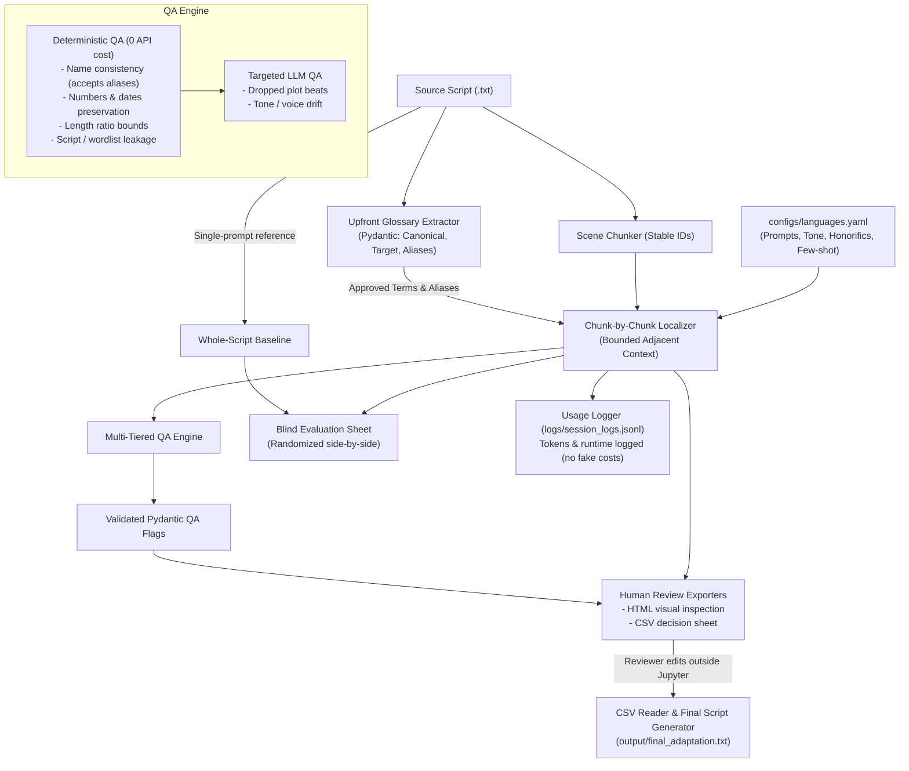

# Audio Drama Script Localization & Review Workbench

A lightweight, notebook-first AI localization tool designed for adapting audio and micro-drama scripts between **Hindi, Hinglish, English, and Marathi**.

Built for an **AI Generalist** role (Kuku AI Labs). The project prioritizes:
1. Solving the real engineering problem: generic machine translation mutates character names, dilutes relational honorifics, drops plot beats/deadlines, and causes reviewer fatigue.
2. Grounded validation: upfront glossary extraction with phonetic alias support, deterministic QA checks (0 API cost), and targeted LLM checks.
3. Offline reviewability: file-based human review (HTML side-by-side view + CSV edit sheets) with full round-trip auditability.
4. Interview defensibility: zero black-box orchestration frameworks (no LangChain, no LlamaIndex, no complex UI wrappers). Every important line of code lives transparently in one notebook.

---

## 1. System Architecture



---

## 2. Minimal Project Structure

```
.
├── localization_workbench.ipynb # The entire workflow in 12 numbered, executable sections
├── configs/
│   ├── languages.yaml           # Language pairs, tone guides, honorifics, few-shot examples
│   └── qa_rules.yaml            # Configurable deterministic thresholds & same-script wordlists
├── data/
│   ├── samples/
│   │   └── sample_script.txt    # Original 3-scene sample drama (Hindi)
│   └── seeded_errors/
│       └── sample_seeded_key.json # Format template for seeded error benchmarking
├── logs/                        # Session logs (JSONL, ignored by Git)
├── output/                      # Generated adaptations, HTML review sheets, CSVs (ignored by Git)
├── .env.example                 # Environment variable template
├── .gitignore                   # Excludes .env, logs/, output/, archive/
├── requirements.txt             # Minimal dependencies (pydantic, pyyaml, python-dotenv, httpx, jupyter)
├── DECISIONS.md                 # Technical trade-offs, architecture decisions & justifications
└── README.md                    # Setup, workflow order, architecture & results section
```

---

## 3. Quickstart & Setup

### Prerequisites
- Python 3.11+
- Jupyter Notebook / JupyterLab / VS Code Notebook Runner

### Installation
```bash
# 1. Clone or open the workspace
cd "d:/Project/KUKU - 1"

# 2. Install lightweight dependencies
pip install -r requirements.txt
```

### Environment Configuration (`.env`)
Copy `.env.example` to `.env`:
```bash
cp .env.example .env
```
Default mode is offline mock mode (`LLM_PROVIDER=mock`). It requires **zero API keys** and runs completely offline with simulated translations and deterministic QA diagnostics.

To connect a live provider, set:
```bash
LLM_PROVIDER=openai
LLM_API_KEY=your_key_here
LLM_MODEL=gpt-4o-mini
```
*(Also supports `groq` with `llama-3.3-70b-versatile` or `gemini` with `gemini-1.5-flash`)*

---

## 4. Notebook Execution Order (`localization_workbench.ipynb`)

Open `localization_workbench.ipynb` and run cells sequentially (1 through 12):

| Section | Title | Purpose & What It Executes |
| :--- | :--- | :--- |
| **Section 1** | **Setup & Configuration** | Loads `.env` safely, validates YAML configs (`languages.yaml`, `qa_rules.yaml`), and initializes thin HTTP LLM client with offline mock mode. |
| **Section 2** | **Input Script** | Loads text from file or string, validates non-empty source, assigns stable hash ID (`script_<hash>`), and lets user select language pair. |
| **Section 3** | **Split the Script** | Chunks text into scenes/dialogue blocks using deterministic screenplay rules; assigns stable IDs (`chunk_id = <script_id>_scene_001`). |
| **Section 4** | **Glossary Extraction & Review** | Extracts character names, honorifics, and phonetic alias variants (e.g., `Vikram` -> `["Bikram", "Vicky"]`) via Pydantic model. Allows manual review before localization. |
| **Section 5** | **Chunk-by-Chunk Localization** | Localizes scene-by-scene with bounded adjacent context and approved glossary terms. Never resends the entire script per request. |
| **Section 6** | **Baseline Comparison** | Runs a naive whole-script single-prompt baseline on the same model to demonstrate why chunking + glossary grounding is superior. |
| **Section 7** | **Deterministic QA** | Runs 0-API-cost checks: character name consistency (accepts all listed aliases), number/date preservation, length ratio, and script/wordlist leakage. |
| **Section 8** | **LLM-Based QA** | Runs a single structured LLM call per scene to identify dropped plot beats, omitted physical actions, or character voice drift. |
| **Section 9** | **Human Review (File-Based)** | Exports `output/review_sheet.html` (side-by-side visual inspection) and `output/review_decisions.csv` (reviewer decision sheet). Reads back completed decisions to produce final verified script. |
| **Section 10** | **Local Usage Log** | Appends session metrics to `logs/session_logs.jsonl` (tokens, elapsed time, chunk count, model). Logs no secrets and invents no fake pricing. |
| **Section 11** | **Evaluation** | Generates a blind side-by-side CSV (`blind_rating_sheet.csv`) for human scoring. Includes a score parser (raw counts, sample size) and seeded error benchmark harness. |
| **Section 12** | **Smoke Tests** | Offline unit test suite verifying chunking, alias tolerance, number QA, script leakage, and CSV round-trip without external network calls. |

---

## 5. Evaluation & Results

> [!NOTE]
> In accordance with rigorous scientific practices, **no benchmark numbers or human ratings are fabricated**. The results section below will be populated once live user trials and blind human scoring are conducted.

### 5.1 Blind Side-by-Side Comparison (Pipeline vs. Baseline)
- **Status**: *Awaiting human scoring.*
- **Methodology**: `output/blind_rating_sheet.csv` randomizes presentation order (Option A vs. Option B) so reviewers cannot identify which output came from the chunked pipeline or naive baseline.
- **Metrics Tracked**: Raw counts of Wins, Ties, and Losses across evaluated scenes, along with explicit sample size ($N$).

### 5.2 Seeded Error Detection Benchmark
- **Status**: *Awaiting ground-truth answer key curation.*
- **Methodology**: Compare deterministic and LLM QA flags against a human-annotated error key (`data/seeded_errors/sample_seeded_key.json`).
- **Metrics Tracked**: Recall (percentage of planted errors caught) and False Alarms (spurious flags raised on clean text).

---

## 6. What Was Mocked vs. What You Must Do Yourself

To ensure total transparency in an interview or project defense:

### What Was Mocked / Automated in Offline Verification:
- **LLM Calls**: In `LLM_PROVIDER=mock` mode, the client simulates realistic Hinglish translations, glossary extraction, and QA flags locally. All 5 smoke tests pass in under 1 second without internet or API keys.
- **Review Round-Trip Test**: Cell 25 uses an automated in-memory CSV to prove that reviewer edits, approvals, and "unreviewed" fallbacks function correctly.

### What You (The Reviewer / Author) Must Do:
1. **Refine Few-Shot Language Examples**:
   - The drafts in `configs/languages.yaml` are marked with `needs_review: true`. Replace them with your own verified, native-grade conversational dialogue for Hindi, Hinglish, and Marathi.
2. **Conduct Live Model Localizations**:
   - Add your API key to `.env` (`LLM_PROVIDER=openai` or `groq`) and run live adaptations on full scripts.
3. **Perform Human Review**:
   - Open `output/review_decisions.csv` in Excel or Google Sheets, fill in `decision`, `corrected_text`, and `approved`, then run the CSV reader in Section 9.
4. **Complete Blind Scoring**:
   - Rate the pairs in `output/blind_rating_sheet.csv` (1 = A better, 2 = B better, 0 = Tie) to generate real evaluation figures.
