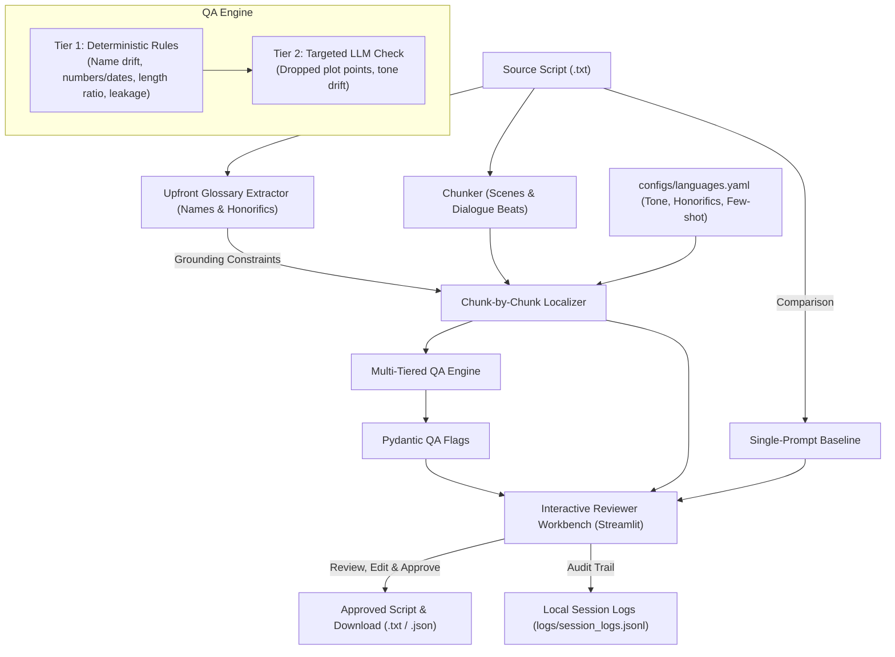

# Kuku Audio Drama Script Localization & Review Workbench

A practical, production-ready AI tool built for adapting audio and micro-drama scripts between **Hindi, Hinglish, English, and Marathi**.

---

## 1. The Problem

Adapting scripts and episodic micro-dramas between Indian languages is slow and error-prone when using generic machine translation or naive single-prompt LLM calls:
- **Character Name Drift**: Proper names morph across scenes (e.g. *विक्रम* becomes *Vikram* in Scene 1, *Bikram* in Scene 3, or gets translated literally as *Valor*).
- **Cultural Honorific Dilution**: Relational markers (*पापाजी*, *भैया*, *काका*, *ताई*, *दादा*, *साहब*) get stripped, translated to western equivalents like "Mister", or mishandled.
- **Dropped Plot Beats**: Omitted physical actions, dropped deadlines, or missed numbers (e.g. *१० लाख रुपये* or *२४ घंटे* omitted).
- **Reviewer Fatigue**: Editors must re-read 100% of the translated text from scratch because plain translation provides zero diagnostic flags.

---

## 2. Architecture & Data Flow



---

## 3. Quickstart

### Prerequisites
- Python 3.11+ (Tested on Python 3.11 - 3.14)

### Installation
```bash
# 1. Clone or open repository
cd "d:/Project/KUKU - 1"

# 2. Create and activate a virtual environment (optional but recommended)
python -m venv venv
# Windows:
.\venv\Scripts\activate
# Linux/Mac:
source venv/bin/activate

# 3. Install lightweight dependencies
pip install -r requirements.txt
```

### Environment Configuration (`.env`)
Copy `.env.example` to `.env`:
```bash
cp .env.example .env
```
Supported providers:
- `LLM_PROVIDER=mock`: Default offline mode. Runs 100% locally with simulated translations and deterministic QA flags without needing any API key.
- `LLM_PROVIDER=openai`: Set `OPENAI_API_KEY` and optional `LLM_MODEL=gpt-4o-mini`.
- `LLM_PROVIDER=groq`: Set `GROQ_API_KEY` and optional `LLM_MODEL=llama-3.3-70b-versatile`.
- `LLM_PROVIDER=gemini`: Set `GEMINI_API_KEY` and optional `LLM_MODEL=gemini-1.5-flash`.

---

## 4. How to Run

### Option A: Interactive Web App (Streamlit)
```bash
streamlit run app/streamlit_app.py
```
**Features in the UI:**
1. **Script & Glossary Tab**: Upload or paste script, review and edit character glossary upfront.
2. **Review & Edit Tab**: Side-by-side source vs. adapted text with real-time QA flags (color-coded by severity: Critical, Warning, Info). Edit directly and approve.
3. **Baseline Comparison Tab**: Side-by-side comparison between structured pipeline and naive single-prompt baseline.
4. **Session Audit Logs Tab**: Inspect verifiable local JSONL run logs and reviewer actions.

### Option B: Command Line Interface (CLI)
Run both the pipeline and baseline on any script file and save outputs:
```bash
python run_cli.py --file data/samples/hindi_drama_short.txt --pair hindi_to_hinglish
```
Outputs saved automatically to `eval/results/`:
- `eval/results/<name>_pipeline_<pair>.txt` (Pipeline output)
- `eval/results/<name>_baseline_<pair>.txt` (Baseline output)
- `eval/results/<name>_qa_report_<pair>.json` (Full structured QA report)

### Option C: Run Unit Tests
```bash
pytest -v
```
Consolidated test suite validates config, chunker, glossary, QA, and pipeline in ~0.15 seconds.

---

## 5. Evaluation Tooling

### 1. Generating Blind Rating Sheets
Creates a randomized side-by-side CSV where Variant A and Variant B are randomly assigned between Pipeline and Baseline. The reviewer evaluates blind:
```bash
python eval/make_rating_sheet.py --pair hindi_to_hinglish
```
- Sheet saved to: `data/ratings/blind_rating_sheet_<pair>_<timestamp>.csv`
- Key saved to: `eval/results/rating_key_<pair>_<timestamp>.json`

### 2. Scoring Human Ratings
Reads the human-filled sheet and unblinds the results to report win/tie/loss counts and average score differentials:
```bash
python eval/score_ratings.py --sheet data/ratings/blind_rating_sheet_<pair>_<timestamp>.csv --key eval/results/rating_key_<pair>_<timestamp>.json
```

### 3. Benchmarking QA Engine on Seeded Errors
Measures **Recall** (detection rate of known injected flaws) and **False Alarm Rate** against a human ground-truth key:
```bash
python eval/score_qa.py --key data/seeded_errors/sample_seeded_key.json
```

---

## 6. Language Configuration

All language pairs live in `configs/languages.yaml`. Adding a language requires **zero code changes**:
```yaml
pairs:
  hindi_to_hinglish:
    source: "hindi"
    target: "hinglish"
    display_name: "Hindi -> Hinglish"
    tone_notes: "Conversational urban drama tone in Latin script..."
    honorific_rules: "Preserve 'ji', 'sahab', 'bhaiya'..."
    name_rules: "Phonetically preserve names (विक्रम -> Vikram)..."
    few_shot_examples:
      - source: "..."
        adapted: "..."
```
Shipped pairs:
1. `hindi_to_hinglish`
2. `hindi_to_english`
3. `hindi_to_marathi`
4. `marathi_to_hindi`
5. `english_to_hindi`

---

## 7. Results Section

> [!NOTE]
> Per the hard rule of this project, **no metrics, ratings, or user feedback are auto-generated or invented**. This section remains an empty template until real human reviews and benchmark runs are conducted.

### Human Preference: Pipeline vs. Naive Baseline
*(To be populated via `eval/score_ratings.py` following human review)*

| Language Pair | Sample Size ($N$) | Pipeline Win (%) | Baseline Win (%) | Tie (%) | Avg Pipeline Score (1-5) | Avg Baseline Score (1-5) |
|---|:---:|:---:|:---:|:---:|:---:|:---:|
| Hindi -> Hinglish | — | — | — | — | — | — |
| Hindi -> English | — | — | — | — | — | — |
| Hindi -> Marathi | — | — | — | — | — | — |
| Marathi -> Hindi | — | — | — | — | — | — |
| English -> Hindi | — | — | — | — | — | — |

### QA Diagnostic Performance (Seeded Error Benchmark)
*(To be populated via `eval/score_qa.py` on human-seeded scripts)*

| Benchmark Test Set | Seeded Errors ($N$) | Errors Caught ($TP$) | Missed ($FN$) | Recall (%) | False Alarms ($FP$) | Precision (%) |
|---|:---:|:---:|:---:|:---:|:---:|:---:|
| Name Drift Test | — | — | — | — | — | — |
| Number / Date Preservation | — | — | — | — | — | — |
| Dropped Plot Points | — | — | — | — | — | — |
| Tone Drift | — | — | — | — | — | — |

### Real Reviewer Usage Metrics
*(To be populated from `logs/session_logs.jsonl` after editorial sessions)*
- Total Editorial Sessions: —
- Average Chunks Per Script: —
- Critical Flags Triaged: —
- Average Review Time: —
